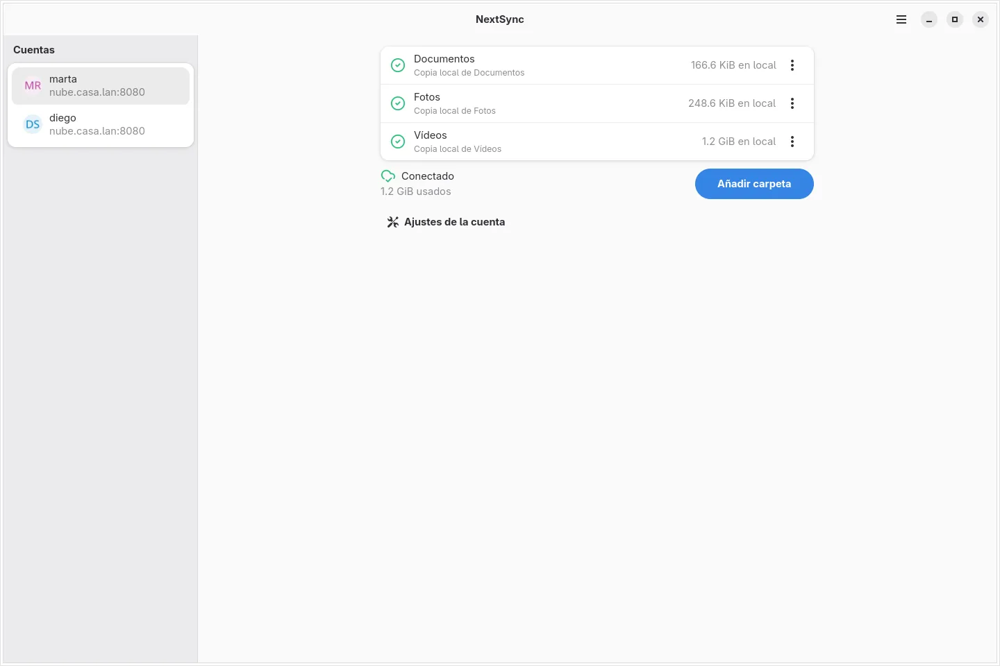

<div align="center">
  
  <h1>NextSync</h1>
  <p><strong>Tus archivos, en local.<br>Cualquier servidor, en sincronía.</strong></p>
  <p>Un cliente de escritorio para GNOME que mantiene un espejo local completo de tus cuentas Nextcloud y OpenCloud.<br>Un único binario Rust. Sin telemetría, sin suscripciones.</p>
  <p>
    <a href="https://nextsync.cloudless.club/">Web</a>
    ·
    <a href="https://github.com/gnacho/nextsync/releases">Releases</a>
    ·
    <a href="https://github.com/gnacho/nextsync/issues">Incidencias</a>
  </p>
  <p>
    <a href="README.md">English</a>
    ·
    <a href="README.es.md">Español</a>
  </p>
  <p>
    <a href="https://github.com/gnacho/nextsync/actions/workflows/ci.yml"></a>
    
    
  </p>
</div>

<p align="center">
  <picture>
    <source media="(prefers-color-scheme: dark)" srcset="landing/assets/shots/main-es-dark.webp">
    
  </picture>
</p>

## Qué es

Tus archivos viven en tu disco. Cuando tu ordenador y tu servidor tienen que ponerse de acuerdo sobre qué ha cambiado, NextSync reconcilia ambos lados con su propio motor de sincronización, escrito en Rust y ejecutado en el mismo proceso que la app: cuentas, configuración por carpeta, progreso en vivo, resolución de conflictos y un icono de bandeja que refleja lo que de verdad está pasando.

No hace falta instalar nada más. El motor habla WebDAV con Nextcloud y OpenCloud directamente, mantiene su propio journal, sube por trozos (chunked v2 en Nextcloud, TUS en OpenCloud) y reanuda las transferencias interrumpidas. Si alguna vez necesitas el comportamiento anterior, Ajustes conserva un interruptor para delegar una carpeta al cliente oficial de línea de comandos.

## Por qué existe

NextSync empezó siendo [nextsync-py](https://github.com/gnacho/nextsync-py), una pequeña app en Python y GTK que envolvía el motor oficial de línea de comandos de Nextcloud en una experiencia de escritorio de verdad. Funcionaba lo bastante bien como para correr cada día, pero todo pagaba el peaje de Python: un intérprete que llevar encima, un arranque que esperar y tipado dinámico que convertía los errores de lifetime de GObject en sorpresas en tiempo de ejecución en vez de en errores de compilación.

La reescritura en Rust llegó por razones prácticas: varias cuentas y varios proveedores en una sola app, un único binario pequeño y un código donde los callbacks asíncronos y los lifetimes de GObject no pueden morder en tiempo de ejecución. La capa de escritorio se reconstruyó por el camino.

Durante un tiempo la reconciliación siguió siendo de los clientes oficiales de línea de comandos. Arrastran años de casos límite, pero también arrastran Qt y un segundo programa que instalar y actualizar. Desde la 0.42 el motor es parte de NextSync: la ventana y la sincronización comparten un proceso, un registro y una misma idea de qué ha cambiado.

## El motor de sincronización

**Descubrimiento.** El motor recorre el árbol remoto con `PROPFIND`, compara ETags para ver qué cambió en el servidor y usa los identificadores de archivo del servidor para detectar renombrados en vez de leerlos como un borrado más una subida. El lado local es un recorrido normal del sistema de archivos. El plan sale de comparar tres estados: lo que hay en disco, lo que hay en el servidor y lo que dejó anotado la última pasada.

**Registro.** Cada carpeta guarda su propio registro de lo sincronizado: ruta, tamaño, fecha de modificación, ETag e identificador de archivo. Ese registro es la memoria que necesita el motor para distinguir un archivo nuevo de uno que borraste aquí y para no transferir nada que no haya cambiado. Es de la app, no la base de datos de otro programa.

**Transferencias.** Los archivos pequeños viajan en una sola petición. Los grandes usan subidas por trozos en Nextcloud y TUS en OpenCloud, ambas reanudables. Las descargas van a un archivo temporal y se renombran al terminar, conservando la fecha de modificación que anuncia el servidor. Una pasada se puede cancelar y los reintentos esperan más en errores del servidor y límites de peticiones.

**Conflictos.** Cuando han cambiado los dos lados, tu copia local se conserva con el mismo nombre `(Nextcloud conflicted copy <fecha>)` que la app ya entiende y la versión remota se descarga al lado. El resolutor de conflictos funciona igual que antes.

**Seguridad.** El motor se niega a propagar un borrado con pinta de borrado masivo: una pasada que fuera a borrar más de la quinta parte de su plan se detiene antes de tocar nada, y no aplica ningún borrado cuando el listado remoto llegó incompleto. La revisión de borrados de la app sigue por encima y detiene la pasada antes de que empiece.

**Tras actualizar.** Las cuentas existentes pasan una sola vez. La primera pasada arranca con el registro vacío y compara tamaño y fecha de modificación en ambos lados: lo que coincide se anota sin transferir y lo que difiere conserva las dos copias como copia en conflicto para que decidas. Un registro vacío no tiene nada que borrar, así que la primera pasada no puede eliminar nada.

**Vuelta atrás.** Ajustes mantiene un interruptor por cuenta. Si lo desactivas, esa cuenta vuelve a `nextcloudcmd` u `opencloudcmd` en la siguiente pasada. Los archivos virtuales y el cifrado en el cliente siguen sin implementarse.

## Qué hace

**Sincronización**

- Varias cuentas y varias carpetas por cuenta, cada una mapeada a su ruta remota o su espacio de OpenCloud.
- Reconciliación bidireccional con motor propio, con transferencias delta y copias en conflicto.
- Un planificador que agrupa los disparadores en una única cola, nunca lanza dos sincronizaciones sobre la misma carpeta y nunca re-ejecuta una carpeta por los eventos de su propia sincronización.
- Notificaciones push del servidor donde el servidor las soporta, con un intervalo de sondeo como alternativa.

**Escritorio**

- Interfaz libadwaita con filas de estado por carpeta y progreso archivo a archivo mientras sincroniza.
- Icono de bandeja que refleja el estado global (sincronizado, sincronizando, en pausa, sin conexión, necesita atención) y un menú para abrir la app o salirla. Cerrar la ventana lo deja todo funcionando.
- Resolución de conflictos desde la app: quedarse con lo local o con lo remoto, archivo por archivo o en bloque.
- Interfaz en español e inglés.

**Redes de seguridad**

- Antes de propagar un borrado masivo local, la sincronización se detiene y la revisión agrupa lo desaparecido por carpeta de primer nivel, con detalles desplegables. Apruebas una vez, restauras desde el servidor o dejas la carpeta en pausa.
- Si el servidor deja de responder, la cuenta pasa a sin conexión en lugar de encadenar errores, y NextSync la sigue sondeando hasta que vuelve.
- Las credenciales rechazadas ponen la cuenta en pausa para las sincronizaciones automáticas en lugar de machacar el servidor a reintentos. Un llavero bloqueado reintenta solo, con un límite acotado.

**Privacidad**

- Sin telemetría, sin analítica, sin informes de errores remotos. Nada sale de tu máquina salvo el tráfico de sincronización con tu propio servidor.
- Las credenciales viven en el Secret Service (llavero de GNOME). Los registros son ficheros locales, uno por día.

## Proveedores

| Proveedor | Motor | Inicio de sesión |
|---|---|---|
| Nextcloud | Nativo, en proceso | Login Flow v2 en el navegador, o contraseña de aplicación |
| OpenCloud | Nativo, en proceso | Contraseña de aplicación desde la web del servidor |

Los dos proveedores pasan por el mismo motor, así que uno nuevo es una capa pequeña de proveedor, no un cambio de arquitectura. El modo heredado sigue disponible por carpeta: un interruptor en Ajustes delega esa carpeta a `nextcloudcmd` o `opencloudcmd` cuando alguno de esos clientes está instalado, para comparar o como salida de emergencia. Las notificaciones push del servidor (`notify_push`) aplican a Nextcloud; las cuentas sin push recurren a un intervalo de sondeo.

## Limitaciones

NextSync mantiene espejos locales completos. No hace todo lo que hacen los clientes oficiales:

- Sin sistema de archivos virtual: los ficheros se descargan siempre enteros, no hay modo solo en línea ni descarga bajo demanda.
- Sin cifrado cliente-servidor (E2E). Si tus carpetas cifradas en el servidor dependen del cliente oficial para descifrar, aquí no se sincronizarán.
- Sin límites de ancho de banda: no hay tope de subida ni de bajada, solo la opción de bajo impacto que baja la prioridad del proceso.

## Instalación

### Arch, CachyOS y derivadas

Descarga el `.pkg.tar.zst` de la [última release](https://github.com/gnacho/nextsync/releases/latest) e instálalo:

```bash
sudo pacman -U nextsync-0.42.0-1-x86_64.pkg.tar.zst
```

El paquete depende de `gtk4` y `libadwaita`. Trae su propio motor de sincronización, así que no hace falta ningún cliente externo. Los paquetes opcionales `nextcloud-client` y `opencloud-desktop` solo sirven si quieres pasar una carpeta a modo heredado.

### Desde el código fuente

Necesitas Rust (cargo) más los paquetes de desarrollo de GTK 4 y libadwaita:

```bash
git clone https://github.com/gnacho/nextsync
cd nextsync
cargo build --release
```

El binario queda en `target/release/nextsync`. Se incluye un `PKGBUILD` por si prefieres generar el paquete completo con `makepkg` en una distribución tipo Arch.

## Primer arranque

1. Añade una cuenta: dirección del servidor y login con el navegador (Login Flow v2 de Nextcloud) o contraseña de aplicación (OpenCloud).
2. Añade carpetas: elige una carpeta local y su correspondencia en el servidor. En cuentas Nextcloud el selector lista tus carpetas existentes; en OpenCloud se escribe la ruta a mano.
3. Si la carpeta local ya tenía ficheros o una sincronización anterior, NextSync muestra lo que va a pasar antes de tocar nada.
4. A partir de ahí sincroniza con los cambios, por calendario y con los push del servidor. Cierra la ventana; la bandeja sigue trabajando.

## Los borrados viajan en ambos sentidos

La sincronización también replica borrados. Si una carpeta desaparece en local, desaparece en el servidor, y al revés. El motor ya frena un borrado con pinta de borrado masivo y la app te pregunta antes de propagarlo, pero una revisión no es una copia de seguridad: guarda una copia independiente de lo que sea importante y nunca apuntes un segundo motor de sincronización a la misma carpeta local.

## Ficheros en disco

| Qué | Dónde |
|---|---|
| Configuración | `~/.config/nextsync/` |
| Estado, registros, avatares | `~/.local/state/nextsync/` |
| Credenciales | Llavero de GNOME (Secret Service) |

## Desarrollo

```bash
cargo test
cargo clippy --all-targets -- -D warnings
cargo fmt --check
```

La batería cubre configuración, credenciales, planificador, motor de sincronización, protocolo push, revisión de borrados y lógica de interfaz, con tests de humo GTK que toleran entornos sin pantalla. CI ejecuta las mismas comprobaciones más un test de paridad i18n que falla si a alguna cadena de la interfaz le falta su traducción al español, y un job de cobertura.

Más en [CONTRIBUTING.md](CONTRIBUTING.md), [SECURITY.md](SECURITY.md) y el [CHANGELOG](CHANGELOG.md).

---

<p align="center"><sub>
Nextcloud es una marca registrada de Nextcloud GmbH. OpenCloud es un producto del Heinlein Group. NextSync es un proyecto independiente y no oficial, sin afiliación, patrocinio ni respaldo de ninguna de las dos compañías.
</sub></p>
